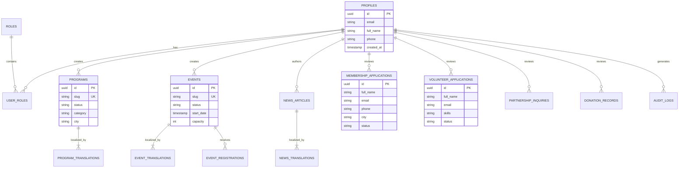

# Database Architecture & Entity Relationship Diagram

## Overview
The AMYCC database is hosted on **PostgreSQL (Supabase)**.
All tables enforce strict **Row Level Security (RLS)** with deny-by-default access control.

---

## Entity Relationship Diagram

---

## Tables & Purpose
1. **`profiles`**: Tied 1:1 with `auth.users` through a PostgreSQL trigger (`on_auth_user_created`).
2. **`roles` & `user_roles`**: Role-based access control supporting 9 explicit roles (`super_admin`, `content_manager`, `membership_manager`, etc.).
3. **`programs` & `program_translations`**: Core cultural programs with multi-language titles, descriptions, and objectives.
4. **`events`, `event_translations`, `event_registrations`**: Event tracking with automated database capacity triggers preventing overbooking.
5. **`news_articles` & `news_translations`**: Association news and press releases.
6. **`membership_applications`**: Secure membership pipeline.
7. **`volunteer_applications`**: Youth in Action candidate pipeline.
8. **`partnership_inquiries`**: Institutional collaboration inquiries.
9. **`donation_records`**: Support notifications and donation audit logs.
10. **`audit_logs`**: System audit trail.

---

## Migrations
- Migration file: `supabase/migrations/001_initial_schema.sql`
- Seed file: `supabase/seed.sql`
